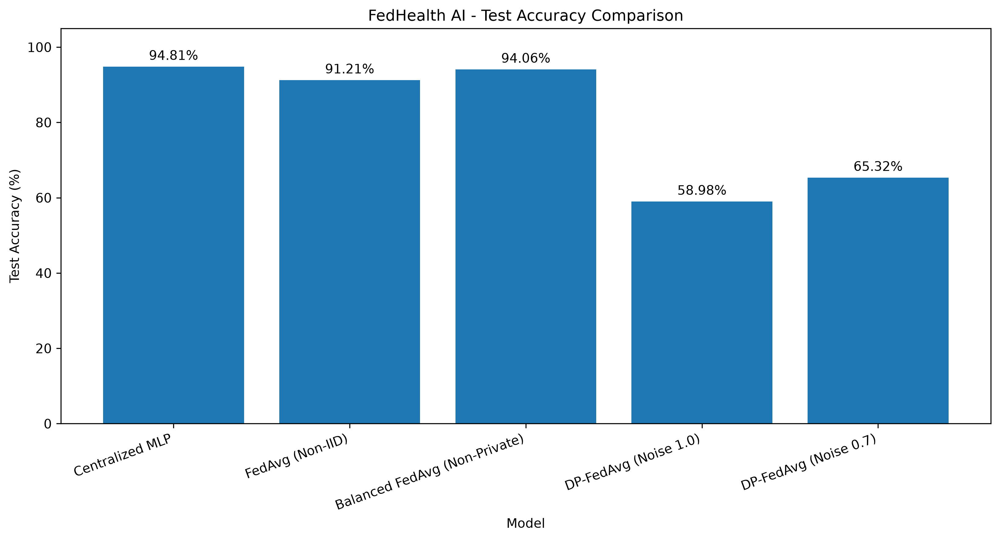
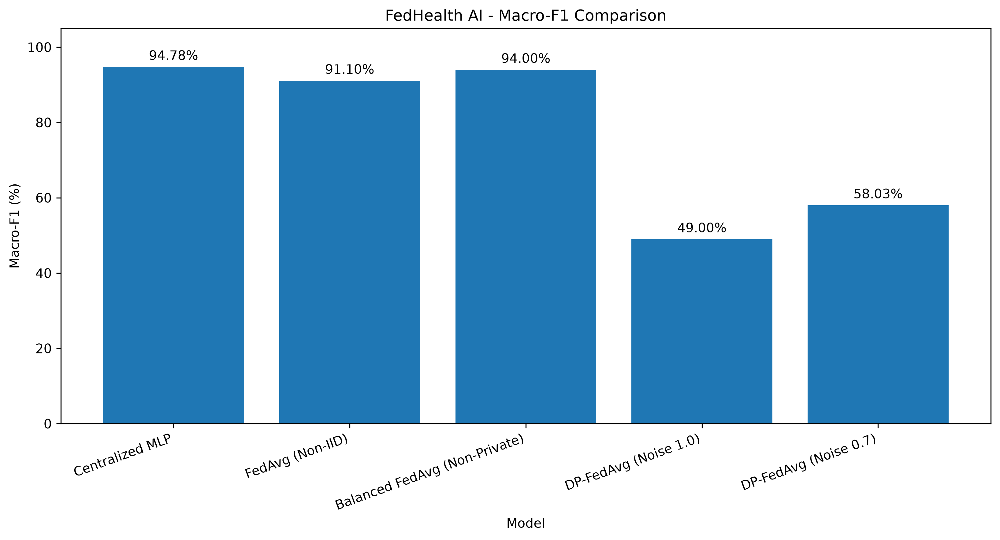
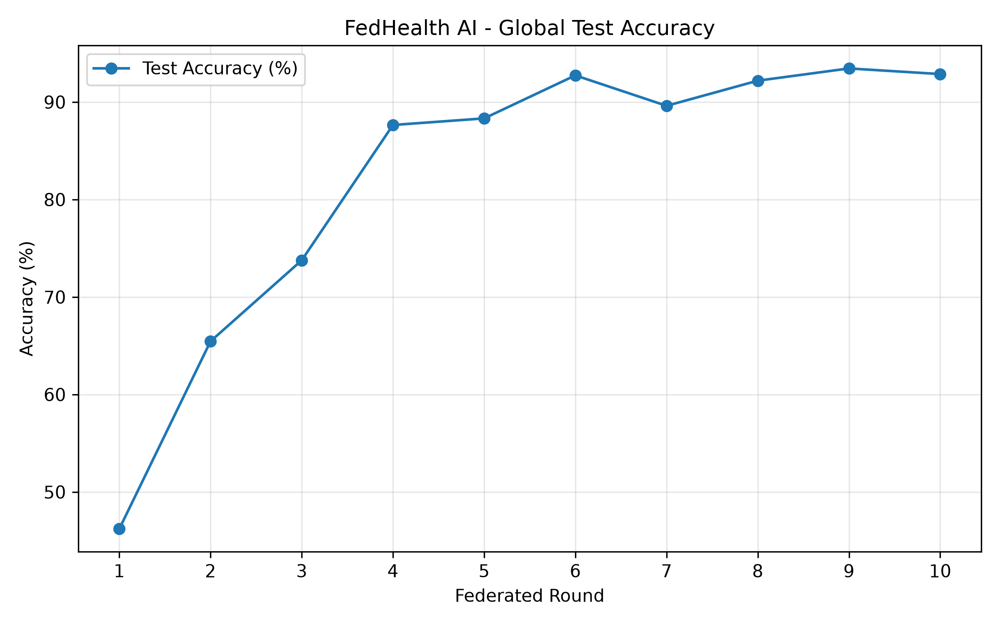
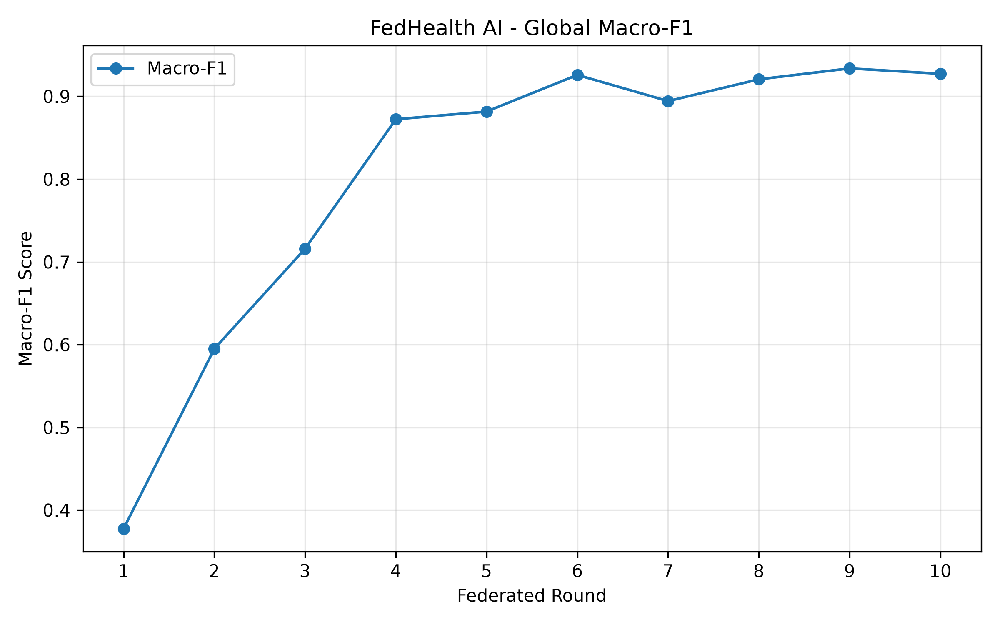
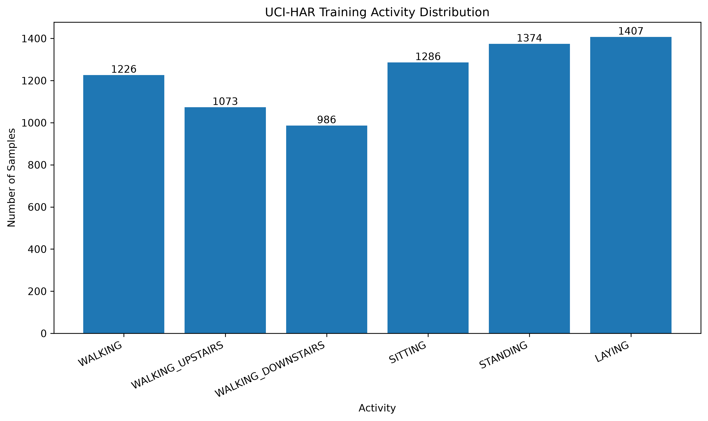
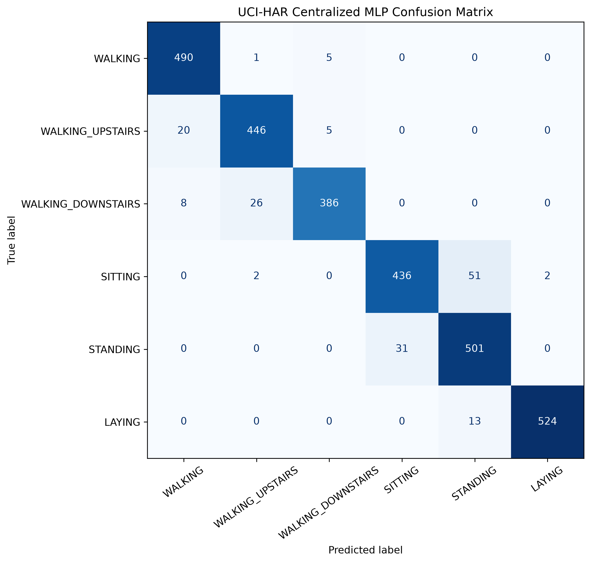

# FedHealth AI 🏥

### Privacy-Preserving Federated Learning for Wearable Human Activity Recognition

FedHealth AI is a machine learning project that explores **Federated Learning (FL)** and **Differential Privacy (DP)** for human activity recognition using wearable sensor data.

The project investigates collaborative model training across multiple simulated clients and evaluates the trade-off between predictive performance and privacy-related training mechanisms.

---

## 🎯 Objectives

- Implement federated learning using Federated Averaging (FedAvg).
- Explore differential privacy during local model training.
- Classify six human activities using wearable sensor features.
- Evaluate model performance under different training configurations.
- Analyze the trade-off between predictive performance and privacy.

---

## 📊 Dataset

This project uses the **UCI Human Activity Recognition Using Smartphones dataset**.

| Dataset Property | Details |
|---|---|
| Input features | 561 |
| Activity classes | 6 |
| Federated clients | 5 |
| Task | Multiclass classification |

### Activity Classes

| Label | Activity |
|---:|---|
| 1 | Walking |
| 2 | Walking Upstairs |
| 3 | Walking Downstairs |
| 4 | Sitting |
| 5 | Standing |
| 6 | Laying |

---

## 🧠 Model Architecture

The project uses a **Multilayer Perceptron (MLP)** for human activity classification.

| Component | Configuration |
|---|---|
| Input layer | 561 features |
| Hidden layer 1 | 128 neurons |
| Hidden layer 2 | 64 neurons |
| Output layer | 6 classes |
| Activation function | ReLU |

---

## 🔄 Federated Learning Workflow

1. The dataset is distributed across five simulated clients.
2. Each client trains a local model using its allocated training data.
3. Local model updates are communicated to the aggregation process.
4. The server combines client updates using Federated Averaging (FedAvg).
5. The aggregated global model is evaluated on held-out test data.
6. Differential privacy experiments investigate how privacy-related training noise affects model performance.

**Note:** The project uses simulated clients. It does not represent a deployment across five physical devices.

---

## 📈 Experimental Results

The following results were reported for selected experiments.

| Experiment | Test Accuracy | Macro F1-score |
|---|---:|---:|
| Non-private FedAvg baseline | 93.25% | 93.19% |
| Differential privacy, 5 local epochs | 76.04% | 70.05% |
| Differential privacy with Sitting class weighting | 76.69% | 71.26% |
| Sitting decision-threshold adjustment | **83.31%** | **81.96%** |

These results are specific to the experiments conducted. The threshold adjustment is a post-processing step applied to model predictions, not a separately trained model.

### Additional Model Comparison

A separate model-comparison CSV in the local results folder reports the following experiments:

| Model | Accuracy | Macro F1-score |
|---|---:|---:|
| Centralized MLP | 94.81% | 94.78% |
| FedAvg (Non-IID) | 91.21% | 91.10% |
| Balanced FedAvg (Non-Private) | 94.06% | 94.00% |
| DP-FedAvg (Noise 1.0) | 58.98% | 49.00% |
| DP-FedAvg (Noise 0.7) | 65.32% | 58.03% |
| Balanced FedAvg (No Dropout) | 93.25% | 93.19% |
| DP-FedAvg (No Dropout, Noise 0.7) | 69.66% | 62.84% |

**Important:** The additional model comparison uses different experiment configurations from the selected results above. Do not treat these rows as interchangeable or directly comparable without checking their training settings.

---

## 📊 Visual Results

The following visualizations are generated from the project's existing experiment outputs.

### 1. Model Accuracy Comparison

Compares the accuracy values represented in the existing model comparison graph.

### 2. Macro F1-Score Comparison

Visualizes the macro F1-score comparison across evaluated models.

### 3. Federated Training Accuracy

Shows the existing federated accuracy history across training rounds.

### 4. Federated Training F1-Score

Shows the existing federated F1-score history across training rounds.

### 5. Activity Distribution

Visualizes the activity distribution represented in the existing dataset plot.

### 6. Confusion Matrix

Visualizes the classification outcomes represented in the existing confusion matrix.

---

## 🛠️ Technologies Used

- **Python** — Core programming language
- **PyTorch** — Neural network implementation
- **Flower** — Federated